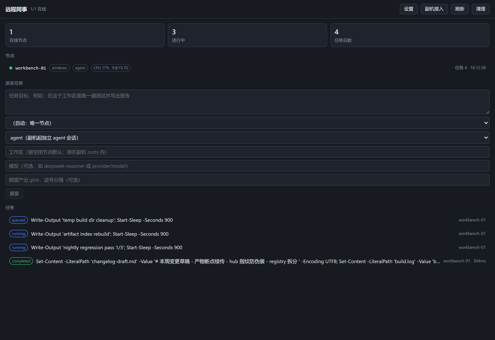
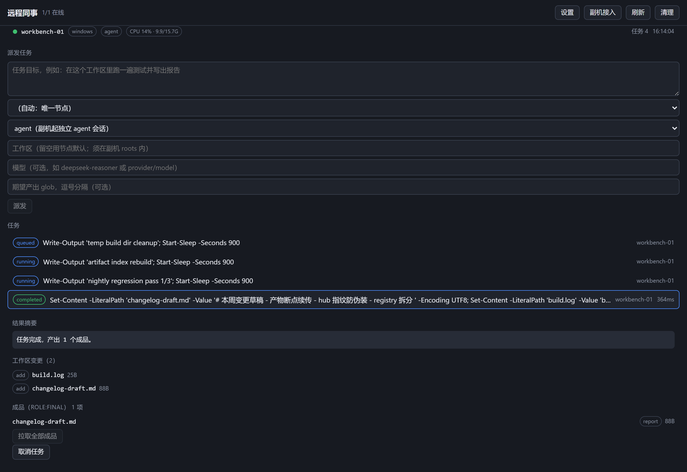

# dsh-remote-agent

**简体中文** | [English](README.en.md)

把另一台电脑变成你 DSH 的**远程 Agent 同事**。

副机拥有自己的 DSH 与独立 Agent 循环，任务在它本地持久运行；主电脑只拿到
**handoff 结果卡**与**产物清单**，成品要显式拉取才过河。

```
┌─────────────── 主电脑（hub）────────────────┐
│  DSH · 模型 · 会话日志 · 全部凭证            │
│  ┌─ dsh-remote-agent ─────────────────────┐ │
│  │ 7 个 remote_* 工具 + Web 面板           │ │
│  └────────────────────────────────────────┘ │
└──────────────────▲──────────────────────────┘
                   │ 节点主动拨入（direct / relay）
┌──────────────────┴──────────────────────────┐
│  ┌─ 副电脑（worker）───────────────────────┐ │
│  │  独立 Agent 循环 · 独立模型上下文        │ │
│  │  D:\work\**  中间产物留在这里            │ │
│  └────────────────────────────────────────┘ │
└─────────────────────────────────────────────┘
```

| | |
|---|---|
| **状态** | 0.3.0 —— 主机侧端到端可用；副机 `exec` 可用，真实运行时拨入已实测（独立进程 worker → 正在运行的 DSH 桌面 hub，见 [KNOWN-ISSUES §8](KNOWN-ISSUES.md)）；`agent` 链路两个根因已修，待两台真机确认 |
| **DSH** | 桌面版 / CLI，0.2.0-rc.2 验证 |
| **平台** | Windows（全量验证）· Linux / macOS（CI 覆盖）|
| **依赖** | **零外部 npm 依赖** —— 只用 `node:` 内置模块 |
| **Node** | `^22.19.0 \|\| >=24.0.0` |

**Web 面板**（侧栏「远程同事」）：节点列表（含 CPU/内存徽章）、派发任务、
任务状态、结果摘要、工作区变更、成品清单、日志尾巴。

<p align="center">
  
</p>

<p align="center">
  
</p>

---

## 五分钟上手

按你的动手能力选一条路线，**每条都通向同一个终点**：

| 路线 | 主机 | 副机 | 适合 |
|---|---|---|---|
| **① 零终端**（Windows） | 双击 `bin/双击运行-配置向导.cmd` → 回车 → Web 面板「副机接入」复制配对码 | 双击同一文件 → 粘配对码 → 回车自动写盘 | 见到黑窗口就慌 |
| **② 向导**（推荐） | 终端跑向导 → 回车确认写盘 | 同左，粘配对码 | 会开终端 |
| **③ 手动** | 参照下文配置节手写 | 手写（`inject: []` 必加） | 想完全掌控每行 |

任一路线完成后：**两台重启 DSH**，对主机说一句「副机上有哪些节点在线？」——
在线即通。出问题跑 `--doctor` 体检，每项 ✗ 都带怎么修。

```bash
node bin/dsh-remote-setup.js
```

> **Windows 不想开终端？** 在插件的 `bin/` 目录里**双击
> `双击运行-配置向导.cmd`** —— 打开的窗口里全程回车即可。
> 插件装在 `%USERPROFILE%\.dsh\dsh_orb\dsh-plugin\dsh-remote-agent\bin\`。

1. **主机上跑**：选「1=主机」→ 向导自动找本机局域网 IP、生成 `nt_` 强随机
   `nodeToken`、输出**副机配对码**（一行 `dshra1://…`）与两台机器的完整 YAML
   （含**防火墙放行命令**）。
2. **副机上跑**：选「2=副机」→ **直接粘贴主机给的配对码**（或手抄地址与
   token）→ 向导会**先探活主机端口**，然后生成副机配置。最坑的 `inject: []`
   已替你填好（不填它副机会永远静默不上线）。副机配置里也可以只写一行
   `pair: '<配对码>'`，运行时自动展开成地址与 token（显式配置优先，写
   `hubUrl:` 可临时覆盖）。
3. 两台重启 DSH，对主机说一句「**副机上有哪些节点在线？**」—— 在线即通。
4. **免终端路径（图形界面）**：打开主机的 Web 面板 →「**副机接入**」按钮 →
   一键生成并复制配对码（含防火墙放行命令）。主机面板派任务时也可在
   「模型」栏指定副机用的模型（留空用副机默认）。
5. 出问题就体检（读取配置文件逐项检查，每项 ✗ 都带怎么修）：

```bash
node bin/dsh-remote-setup.js --doctor 你的配置.yml
```

不想交互？一条命令直接生成：`--role worker --hub-url 192.168.1.10:19387
--token nt_xxx --roots D:\work --node-id slave-pc`。

---

## 核心不变式

这几条是这个包的设计前提，改动前请先读：

| 不变式 | 含义 |
|---|---|
| **凭证不离开副机** | 协议里不带模型 key；副机用自己的模型配置 |
| **断连不终止任务** | 任务在副机本地持久运行，中继挂了也跑完，重连后自动对账 |
| **清单先于字节** | 任务结束只回 manifest + handoff；成品要 `remote_pull` 才传输 |
| **只有 `role:final` 过河** | 日志/缓存/中间构建文件只在副机留存，仅上报元数据 |
| **断点续传** | `remote_pull` 途中掉线/超时不从头重传：已收字节保留，重试自动从中段续传，全文 sha256 校验照旧 |

---

## 安装

### 主机（hub）

```bash
# 通过 DSH 插件安装器（GitHub 源）
dsh plugin add github:zbzbhs/dsh-remote-agent

# 或通过 npm
npm install -g dsh-remote-agent
```

或在 DSH 的插件对话框里填 `github:zbzbhs/dsh-remote-agent`。

装完在 `cordis.patch.yml` 里确认这一行存在（包内 patch 会自动插入）：

```yaml
- id: remote-agent
  name: dsh-remote-agent
  inject: ['webServer', 'tools', 'systemPrompt']
  config:
    role: hub
```

### 副机（worker）

**同一份包**，但配置不同 —— 关键是**必须加 `inject: []`**：

```yaml
- id: remote-agent
  name: dsh-remote-agent
  inject: []                    # ← 副机必加，否则永不激活（见下方说明）
  config:
    role: worker
    nodeId: slave-pc
    transportMode: direct
    hubUrl: 'ws://<主机地址>:19387/api/remote-agent/node'
    token: '<与主机 nodeToken 相同，或留空>'
    roots: ['D:\work']          # ← 改成副机真实存在的目录
```

**嫌抄地址容易错？用配对码** —— 主机向导会输出一行 `dshra1://…`（内含
地址与 token），副机配置里 `transportMode/hubUrl/token` 三行换成一行：

```yaml
  config:
    role: worker
    pair: 'dshra1://eyJ2IjoxLC…'   # ← 主机向导输出的整行
    roots: ['D:\work']
```

> **配对码的两条规矩**
>
> 1. **它内含 token，等同凭证** —— 当面或加密聊天传，不要贴公开群。
> 2. **`roots` 不在配对码里** —— 副机能操作哪些目录是副机自己的安全
>    边界，永远由副机配置声明，主机侧的串决定不了它。
>
> 显式配置优先：`pair` 与 `hubUrl` 同时存在时 `hubUrl` 生效，方便临时换地址调试。
> 配对码坏了不会让副机起不来 —— 只记一条警告并按未配置处理（`--doctor` 会报）。

> **hub 身份认证（默认开启）**：副机也会验主机。hub 首次启动生成持久身份
> （指纹 `hubfp1-…`，落 `~/.dsh-remote-agent/hub-identity.json`），配对码
> 自动携带指纹 —— 副机粘码即完成首连钉住（TOFU，状态在副机
> `~/.dsh-remote-agent/hub-pin.json`）。手动配置可写
> `pinnedHubFingerprint: hubfp1-…` 显式钉住；之后指纹不匹配 = 拒绝上线并
> 停止重连（确认主动换 hub 后删 `hub-pin.json` 重启即可重新钉住）。
> 详见 [SECURITY.md](SECURITY.md) 检查清单第 7 条。

> **为什么副机要写 `inject: []`**
>
> 包内 `cordis.patch.yml` 给这一行声明了
> `inject: ['webServer','tools','systemPrompt']` —— 那是 **hub 需要的服务**。
> 副机 profile 里**没有**这些服务，不清空的话这一行会一直停在 **PENDING**
> **永远不激活**，副机也就永远不拨入。loader 按 id 覆盖，所以写 `inject: []`
> 就覆盖掉了包内的声明。

**接入路径**（双方都在 NAT 后 / 一方有公网 / 隧道）见
**[profiles/README.md](profiles/README.md)** —— 那里有每条路径的配置片段与验证命令，
以及一条**降级链**：能直连走 direct，不通就降级到中继 VPS 或 cloudflared 隧道；
链路全断时副机本地续跑、重连自动对账。中继的 VPS 部署模板（含 TLS 前置）
在 [deploy/relay-vps/](deploy/relay-vps/)。

---

## 用法

装好后**不需要记命令**，直接说话：

| 你说 | agent 调用 |
|---|---|
| 「副机上有哪些节点在线？」 | `remote_nodes` |
| 「让副机在 D:\work 里跑一下测试」 | `remote_task` |
| 「那个任务怎么样了？」 | `remote_status` |
| 「给我个汇总」 | `remote_handoff` |
| 「有哪些成品？」 | `remote_manifest` |
| 「把 report.pdf 拉过来」 | `remote_pull` |
| 「取消那个任务」 | `remote_cancel` |

另有一个 Web 面板（侧栏「远程同事」）：节点列表（含 CPU/内存/负载）、派发任务、
任务状态、结果摘要、工作区变更、成品清单、日志尾巴。

### 工具速查

<details>
<summary><code>remote_task</code> 的参数</summary>

| 参数 | 说明 |
|---|---|
| `goal` | 任务目标。`mode=agent` 时是给副机 agent 的任务书；`mode=exec` 时是要执行的命令 |
| `node` | 目标节点 id。省略时自动选：多节点按在跑任务数/CPU/内存自动路由（agent 模式只选支持 agent 的节点） |
| `repo` | 按仓库路由：传仓库名 / 远端 url 片段 / 本机路径片段，任务派给持有该仓库的节点（多个时按负载自动选）。省略 `workspace` 时自动用仓库在本机的路径。副机接入后自动上报 roots 下的 git 仓库（凭证打码，每 10 分钟刷新） |
| `workspace` | 副机上的绝对路径，必须在节点 `roots` 内。省略用默认 |
| `mode` | `agent`（副机起独立 agent 会话，默认）/ `exec`（直接跑命令）|
| `model` | 可选。副机用的模型（仅 `mode=agent` 生效）：`{model:"deepseek-chat"}` 或 `{provider:"openai",model:"gpt-4o"}`。只传选择不传凭证 —— 副机用自己的 provider 配置跑；headless 后端不支持 |
| `outputs` | 期望产出物的 glob（相对工作区），用于产物清单筛选 |
| `timeoutMs` | 副机侧超时，默认 1 小时 |
| `denyPaths` | 额外禁止访问的绝对路径 |
| `artifactRules` | 覆盖内置产物角色判定，例如 `{ intermediate: ["build/**"] }` |

**`exec` 模式在 Windows 副机上跑的是 PowerShell** —— 用 `;` 分隔命令，
不要用 `&`（会被拒）。需要 cmd 语法时显式 `cmd /c "..."`。

</details>

---

## 安全

**这个插件让主机能在另一台电脑上读写文件、执行命令。** 部署前请读
**[SECURITY.md](SECURITY.md)**，尤其这三条：

1. **`nodeToken` 默认不校验** —— 公网部署**必须**配。留空只适用于完全可信的私网
   （Tailscale / 同机 / 可信 LAN）。
2. **传输不自带 TLS** —— 公网直连必须在前面放 TLS 反代，用 `wss://`。
3. **`roots` 是真正的安全边界** —— 只给任务需要的目录，不要给整个盘或用户 home。

---

## 结构

| 路径 | 作用 |
|---|---|
| `lib/index.js` | 插件入口（角色分发器：`role: hub` / `worker` / `both`） |
| `lib/hub/**` | 主机侧：节点注册表、7 个工具、subagent provider、UI 路由 |
| `lib/hub/views.js` | **投影共享层** —— 工具与 UI 用同一份字段白名单 |
| `lib/node/**` | 副机侧：拨入、任务引擎、产物服务、exec/agent 双后端 |
| `lib/client.js` | 浏览器半边（Web 面板） |
| `lib/protocol.js` | 线协议（帧类型、错误码、`PROTOCOL_VERSION`） |
| `lib/setup.js` + `bin/dsh-remote-setup.js` | 小白向导（配置生成 / doctor 体检 / 连接错误人话翻译） |
| `lib/relay.js` + `bin/dsh-remote-relay.js` | 中继（NAT 场景的会合点） |
| `profiles/**` | 部署档案与配置片段 |
| `scripts/**` | 中继初始化（systemd / 计划任务）+ 质量检查脚本 |

---

## 开发

```bash
npm install     # 只为验证 lockfile；本包零外部运行时依赖
npm run check   # 打包自洽性 + 文档漂移 + 全部测试
```

**没有构建步骤。** `lib/**` 里的 `.js` 就是 DSH 实际加载的产物（纯 ESM，无转译）。

改代码前请读 **[CONTRIBUTING.md](CONTRIBUTING.md)** —— 那里记了几个
**会静默失败**的陷阱（工具返回值出边界、cordis 生命周期、`ctx.get()` 的必要性）。

> `node --test test/`（目录形式）在 Node 24 下会把目录当模块入口，必然失败。
> 用 `npm test`。Windows 的 PowerShell 不展开 glob，也别直接传 `test/*.test.js`。

### 质量防线

| 层 | 命令 | 内容 |
|---|---|---|
| 打包自洽 | `npm run check:packaging` | `files`/`exports`/`bin`/`dsh.bundle.patch` 指向的路径必须存在 |
| 文档漂移 | `npm run check:docs` | 102 条断言，锁住文档与代码的关键约定 |
| 行为测试 | `npm test` | 652 条 |

---

## 已知问题

见 **[KNOWN-ISSUES.md](KNOWN-ISSUES.md)** —— 记录了**刻意不做**的项、
**待补验**的项、以及排查方法论。要点：

- 副机 `agent` 后端不工作（`exec` 正常）—— 待定位
- Windows 8.3 短名绕过向量未验证
- POSIX 分支的平台实测覆盖不足（只跑过 CI）

---

## 更新日志

见 **[CHANGELOG.md](CHANGELOG.md)** —— 含每个修复的**根因分析**。
0.x 期间 `lib/**` 是加载产物，任何变更都可能是行为变更，升级前请读。

---

## 许可

MIT —— 见 [LICENSE](LICENSE)。
